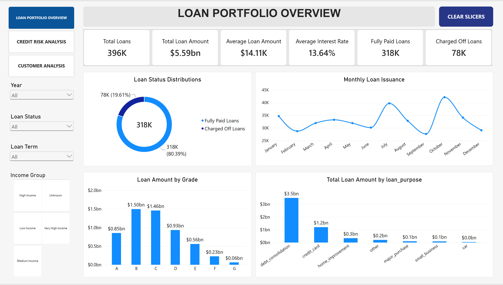
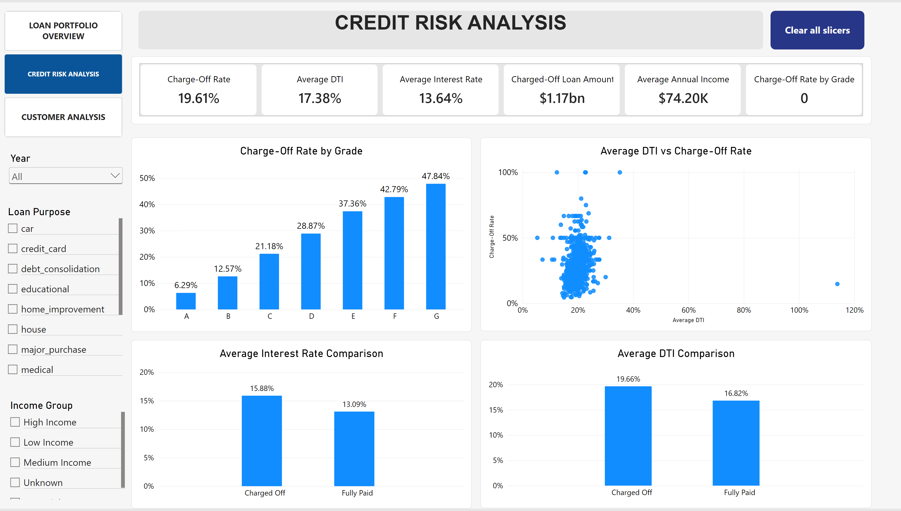
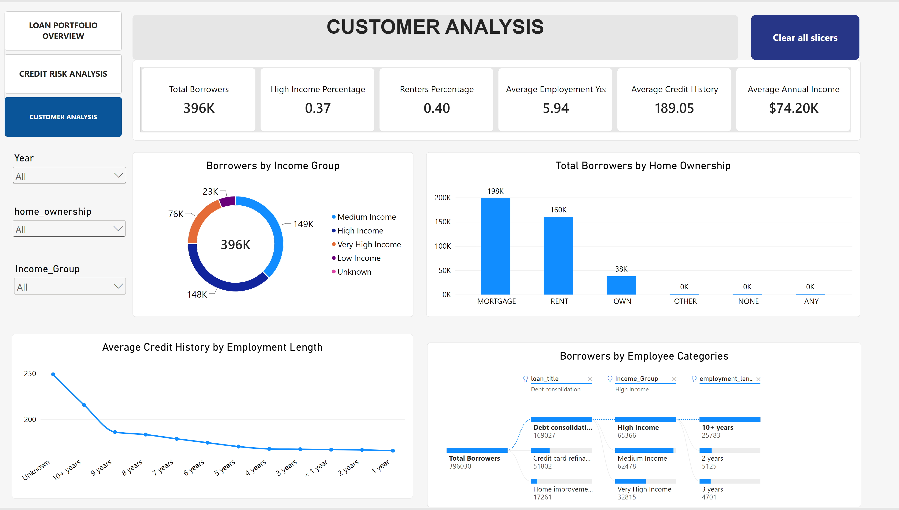

# 🏦 Bank Loan Analytical Project

An end-to-end data analytics project using **LendingClub loan data** — covering raw data ingestion, Excel cleaning, SQL analysis, and Power BI dashboarding.

---

## 📁 Project Structure

```
Bank Loan Analytical Project/
├── 01_Raw Data/                    # Original CSV dataset
├── 02_Excel_Cleaned_Data/          # Initial cleaning in Excel
├── 03_SQL_queries/                 # SQL scripts for DB setup & analysis
├── 04_Power_bi_files/              # Power BI semantic model & dashboard
├── screenshots/                    # Dashboard page screenshots
└── LendingClub_Dashboard.pptx      # PowerPoint presentation with dashboard
```

---

## 1️⃣ Raw Data — `lending_club_loan_two.csv`

**Source:** LendingClub public loan dataset  
**Location:** `01_Raw Data/lending_club_loan_two.csv`

### Key Columns

| Column | Description |
|---|---|
| `loan_amnt` | Requested loan amount |
| `term` | Loan term (36 or 60 months) |
| `int_rate` | Interest rate |
| `grade` / `sub_grade` | LendingClub risk grade (A–G) |
| `emp_length` | Borrower employment length |
| `home_ownership` | RENT / OWN / MORTGAGE |
| `annual_inc` | Borrower annual income |
| `loan_status` | **Fully Paid** or **Charged Off** |
| `purpose` | Loan purpose (debt consolidation, credit card, etc.) |
| `dti` | Debt-to-income ratio |
| `earliest_cr_line` | Date of borrower's earliest credit line |
| `revol_util` | Revolving credit utilization |
| `pub_rec_bankruptcies` | Number of public record bankruptcies |

> The raw file contains ~27 columns with mixed data types, whitespace issues, and some null values that are handled in subsequent steps.

---

## 2️⃣ Excel Cleaning — `Loan_Data_Cleaning.xlsx`

**Location:** `02_Excel_Cleaned_Data/Loan_Data_Cleaning.xlsx`

Initial data profiling and cleaning performed in Excel before loading into SQL:

- Identified columns with missing/null values
- Checked for duplicate records
- Reviewed data types and formatting inconsistencies (e.g., `term` had leading spaces like `" 36 months"`)
- Flagged invalid entries in `revol_util` and `open_acc`
- Used as a reference for the SQL cleaning logic

---

## 3️⃣ SQL Analysis — `BankLoanAnalysis` Database

**Location:** `03_SQL_queries/`  
**Database:** SQL Server — `BankLoanAnalysis`

### Setup & Cleaning Scripts

| Script | Purpose |
|---|---|
| `01_DB_Creation_BankLoanAnalysis.sql` | Creates the `BankLoanAnalysis` database |
| `02_Preview_records.sql` | Quick data preview |
| `03_missing_count_values.sql` | Counts nulls per column |
| `04_Cleaned_record_to_new_tables.sql` | Cleans & moves data to `dbo.loan_data_cleaned` |
| `05_Check_for_duplicate_remove.sql` | Detects and removes duplicates |
| `06_check_for_invalid_data.sql` | Validates data integrity |

### Cleaning Highlights (`04_Cleaned_record_to_new_tables.sql`)

```sql
SELECT
    loan_amnt,
    TRIM(term) AS term,
    TRY_CONVERT(INT, open_acc) AS open_acc,
    TRY_CONVERT(DECIMAL(8,2), revol_util) AS revol_util,
    TRIM(emp_title) AS emp_title
INTO dbo.loan_data_cleaned
FROM dbo.loan_data
```

- `TRIM()` applied to text columns to remove whitespace
- `TRY_CONVERT()` used for safe type casting
- Results stored in a clean table `dbo.loan_data_cleaned`

### Analysis Scenarios

| Script | Scenario |
|---|---|
| `07_...` | **Loan Performance** — Total loans, Fully Paid %, Charged Off % |
| `08_...` | **Grade Risk Analysis** — Charge-off rate by loan grade (A–G) |
| `09_...` | **Top 5 Loan Purposes** by total loan amount |
| `10_...` | **Employment Length** vs loan performance |
| `11_...` | **Home Ownership** vs loan performance |
| `12_...` | **Loan Issuance Trend** by year and month |
| `13_...` | **Charge-off Analysis** by grade |
| `14_...` | **Income vs Loan Amount** analysis |
| `15_...` | **Overall Credit Risk Summary** |

#### Example — Scenario 01: Loan Performance

```sql
SELECT *,
    Fully_Paid_loan_count * 100.0 / NULLIF(Total_number_of_loans, 0) AS Percentage_of_Fully_Paid_loans,
    Charged_Off_loan_count * 100.0 / NULLIF(Total_number_of_loans, 0) AS Percentage_of_Charged_Off_loans
FROM (
    SELECT
        COUNT(*) AS Total_number_of_loans,
        SUM(CASE WHEN loan_status = 'Fully Paid' THEN 1 ELSE 0 END) AS Fully_Paid_loan_count,
        SUM(CASE WHEN loan_status = 'Charged Off' THEN 1 ELSE 0 END) AS Charged_Off_loan_count
    FROM dbo.Loan_data
) t
```

---

## 4️⃣ Power BI Dashboard — `LendingClub_Dashboard.pbip`

**Location:** `04_Power_bi_files/`  
**File:** `LendingClub_Dashboard.pbip`

### Data Source (Power Query / M)

The semantic model loads directly from the CSV file with full transformation applied in Power Query:

- Removed `address` column
- Trimmed and cleaned all text columns
- Replaced empty strings with `null`
- Cast all columns to correct data types
- Added calculated columns:

| Calculated Column | Logic |
|---|---|
| `loan_term_months` | Extracted numeric months from `term` string |
| `loan_status_category` | `"Fully Paid"` → `"Good Loan"`, `"Charged Off"` → `"Bad Loan"` |
| `issue_month` / `issue_year` | Extracted from `issue_date` |
| `employment_length_years` | Parsed `emp_length` string to integer (0–10) |
| `Income_Group` | Bucketed `annual_inc` into Low / Medium / High / Very High |
| `Loan_ID` | Auto-incremented index |
| `Credit History Years` | `DATEDIFF(earliest_credit_line_date, issue_date, MONTH)` |

### DAX Measures (`00_Measures` table)

| Measure | Formula |
|---|---|
| `Total Loans` | `COUNTROWS(lending_club_loan_two)` |
| `Total Loan Amount` | `SUM([loan_amount])` |
| `Average Loan Amount` | `AVERAGE([loan_amount])` |
| `Average Interest Rate` | `AVERAGE([interest_rate])` |
| `Fully Paid Loans` | `CALCULATE([Total Loans], loan_status = "Fully Paid")` |
| `Charged Off Loans` | `CALCULATE([Total Loans], loan_status = "Charged Off")` |
| `Fully Paid Percentage` | `DIVIDE([Fully Paid Loans], Total Loans with REMOVEFILTERS)` |
| `Charge-Off Rate` | `DIVIDE([Charged Off Loans], Total Loans with REMOVEFILTERS)` |
| `Average DTI` | `AVERAGE([debt_to_income_ratio])` |
| `Average Annual Income` | `AVERAGE([annual_income])` |
| `Average Revolving Utilization` | `AVERAGE([revolving_utilization])` |
| `Charge-Off Rate by Grade` | `DIVIDE([Charged Off Loans], [Total Loans])` |
| `High Income Percentage` | `DIVIDE(loans where Income_Group = "High Income", Total Loans)` |
| `Renters Percentage` | `DIVIDE(loans where home_ownership = "RENT", Total Loans)` |

### Dashboard Pages

The report contains **3 pages** with visuals covering:

- Loan performance overview (KPIs, status breakdown)
- Grade & risk analysis
- Trend analysis (monthly/yearly issuance, income groups, home ownership)

### 📸 Dashboard Screenshots

**Page 1 — Loan Performance Overview**


**Page 2 — Grade & Risk Analysis**


**Page 3 — Trend Analysis**


---

## 🔄 Data Flow

```
lending_club_loan_two.csv
        │
        ▼
  Excel (profiling & initial cleaning)
        │
        ▼
  SQL Server (BankLoanAnalysis DB)
  ├── Raw table: dbo.loan_data
  ├── Cleaned table: dbo.loan_data_cleaned
  └── 9 analysis scenarios
        │
        ▼
  Power BI (Power Query + DAX)
  ├── Semantic Model (lending_club_loan_two)
  ├── Calculated columns & Income Groups
  ├── DAX Measures table (00_Measures)
  └── 3-page interactive dashboard
```

---

## 🛠️ Tools Used

| Tool | Version / Notes |
|---|---|
| Microsoft Excel | Data profiling & initial cleaning |
| SQL Server | T-SQL, database `BankLoanAnalysis` |
| Power BI Desktop | `.pbip` format (Power BI Projects) |
| Power Query (M) | ETL transformations inside Power BI |
| DAX | Measures and calculated columns |
